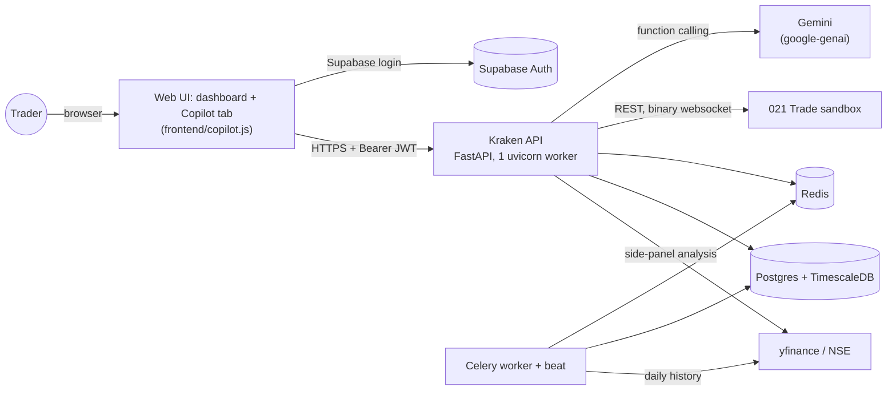
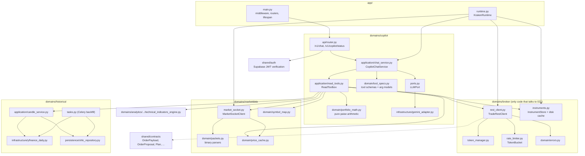
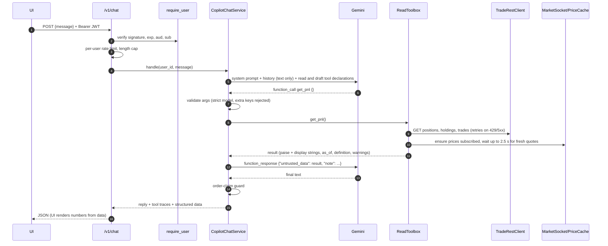
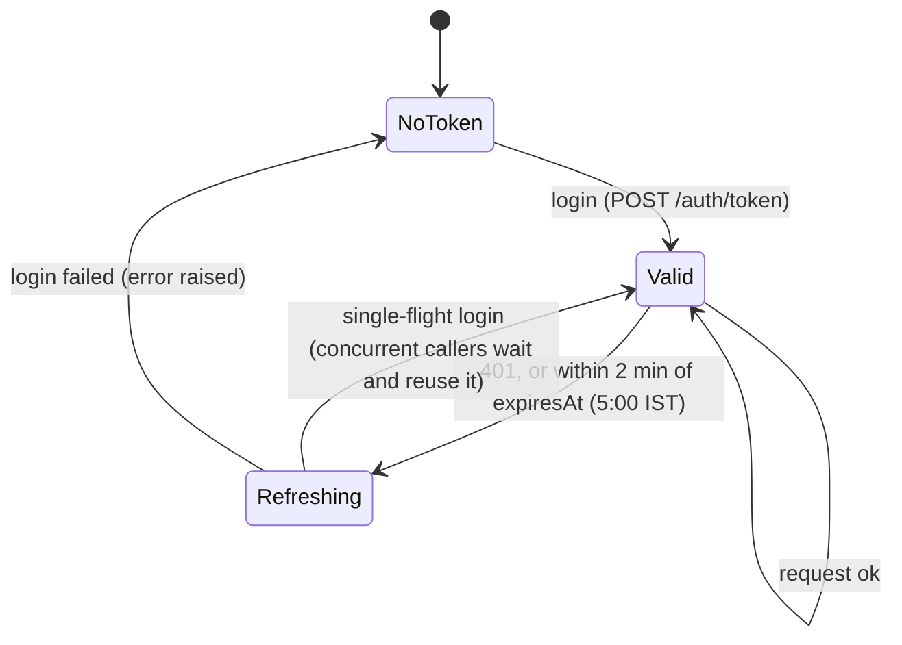
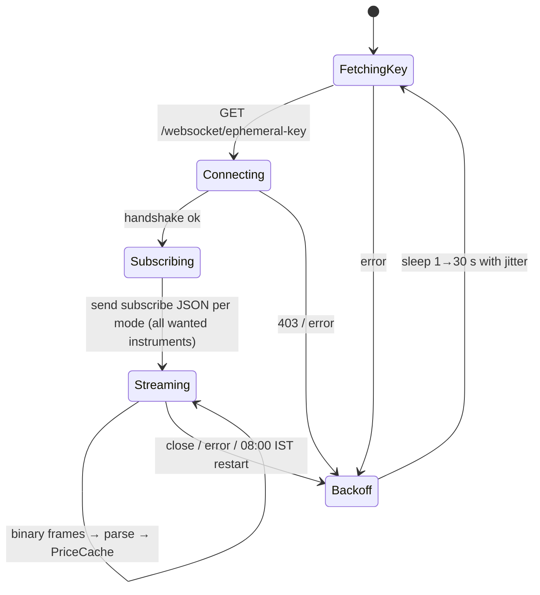
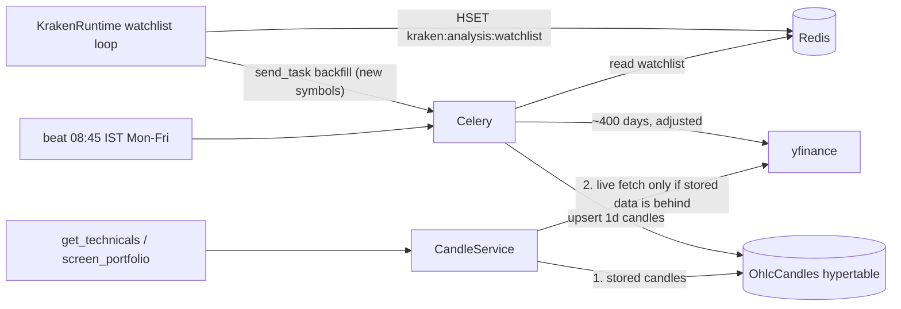
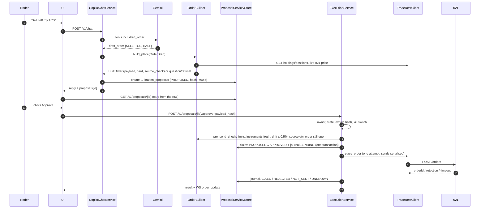
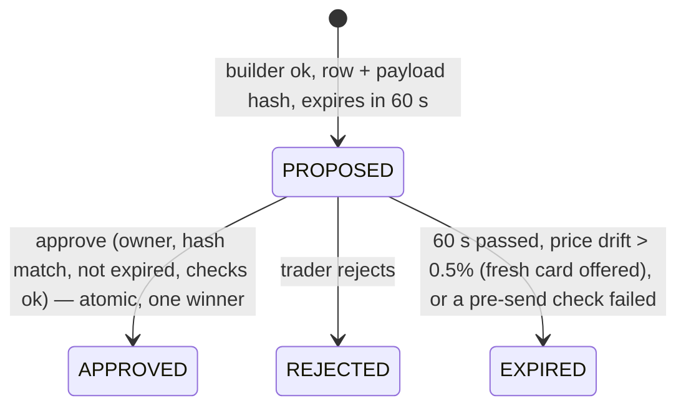
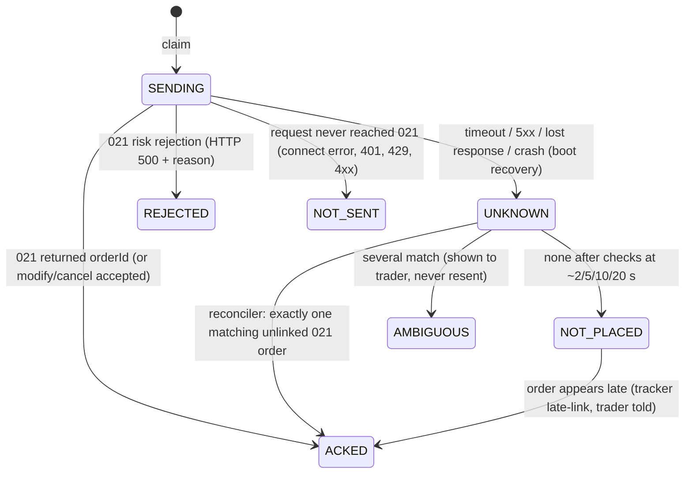

# Kraken architecture

This page describes the system as it is built today: Level 1 (read-only questions) and Level 2 (orders with confirmation). Parts planned for Levels 3–4 are marked **planned** and do not exist in the code yet. See [ROADMAP.md](ROADMAP.md).

## 1. The invariant

> The LLM can read and draft. It never has a tool that sends, modifies, cancels or approves an order.

Draft tools ([draft_tools.py](../domains/copilot/application/draft_tools.py)) only save a proposal row. Deterministic code ([order_builder.py](../domains/copilot/application/order_builder.py)) turns the draft into an exact 021 payload. The **only** code path that sends anything to 021 is:

```
POST /v1/proposals/{id}/approve  (authenticated human click)
  └─ ExecutionService.approve()  (owner, hash, expiry, kill switch, re-checks, atomic claim)
       └─ TradeRestClient.place_order / modify_order / cancel_order   (one attempt, never retried)
```

See [DECISIONS.md](DECISIONS.md), ADR-001 and ADR-003.

## 2. System context



Everything except Supabase, Gemini, 021 and yfinance/NSE runs in one container ([Dockerfile](../Dockerfile), [docker/supervisord.conf](../docker/supervisord.conf)): uvicorn, Celery worker, Celery beat, Redis, Postgres/Timescale and the ingestion orchestrator. Only port 8000 is published.

## 3. Components



| Module | Responsibility | Owner (team split) |
|---|---|---|
| `domains/broker` | 021 login, REST calls, error types, rate limit, read retries, instruments master | A |
| `domains/marketdata` | Market socket, binary parsing, price cache, 021 ↔ yfinance symbol map | B |
| `domains/historical` | Daily candles: Timescale store, yfinance fetch, Celery backfill | B |
| `domains/copilot` | LLM port and Gemini adapter, read tools, draft tools, order builder/validator, price parsing, chat orchestration, chat API | C (tools/LLM/builder), D (API) |
| `domains/orders` | Proposal service, execution service, reconciler, order tracker, user hub, order store (memory/Postgres), orders API | A (execution, journal, reconciler), D (proposal store, API, audit) |
| `domains/marketdata/infrastructure/orders_socket.py` | Orders websocket client with REST catch-up on reconnect | B |
| `shared/contracts` | Cross-team Pydantic models (paise ints, `extra="forbid"`) | all; changes need review from both sides of a seam |
| `shared/auth`, `shared/middleware/auth.py` | Supabase JWT verification | D |
| `domains/analytics`, `domains/ingestion`, `domains/notifications` | Inherited analysis feed, side-panel endpoints and legacy alerts | B / D |

## 4. Process model

- **One uvicorn worker.** 021 allows one live token per account, and a new login revokes the previous token. The worker owns the only `TradeRestClient`, its `TokenManager` and the market socket ([ADR-002](DECISIONS.md#adr-002-one-uvicorn-worker-owns-the-021-session)).
- **`KrakenRuntime`** ([app/runtime.py](../app/runtime.py)) is created in the FastAPI lifespan and stored on `app.state.kraken`. It starts three background activities:

| Loop | Interval | What it does |
|---|---|---|
| Instruments | checks every 30 min | Loads today's disk cache at startup; downloads the 021 instruments CSV when the cache is not from today's IST date |
| Market socket | continuous | Connect → resubscribe → read; reconnects with backoff (1 s doubling to 30 s, ×0.5–1.5 jitter) |
| Watchlist | every 60 s | Reads holdings and positions, pins their prices on the socket (`ltpc` mode), publishes the analysis watchlist to Redis, and queues a backfill for new symbols |

- **Celery** runs analysis jobs only (option-chain snapshots, daily candle backfill at 08:45 IST on weekdays). It never logs in to 021. It reads the watchlist from the Redis hash `kraken:analysis:watchlist` that the app writes ([domains/historical/tasks.py](../domains/historical/tasks.py)).
- If the 021 credentials are missing, the runtime starts with broker features disabled, and tools answer "021 credentials are not configured".

## 5. Request flow: a chat question



Limits: at most `CHAT_MAX_TOOL_CALLS` (6) tool calls per message, 25 s per tool call, and the last 12 text messages (user + assistant) are remembered per user. Tool results are never stored in the history.

## 6. Two price sources, one rule

| Source | Used for | Never used for |
|---|---|---|
| **021** (REST + market socket) | Positions, holdings, trades, P&L, LTP, option chain (`oc` mode), and (planned) every order price, trigger and drift check | — |
| **yfinance / NSE** | Daily history for indicators; the inherited option-chain side panel | Order prices, P&L, triggers |

`get_technicals` compares the latest analysis price with the 021 LTP and flags any gap above 1%. Symbol mapping lives in [symbol_map.py](../domains/marketdata/domain/symbol_map.py): `<SYMBOL>.NS` for NSE cash, `.BO` for BSE, plus an explicit index table. Unmappable instruments are reported as skipped.

## 7. The 021 gateway

### Token lifecycle



### Retry policy

| Request | 429 / 500 / 503 / timeout / non-JSON | 401 | Connection never opened |
|---|---|---|---|
| **Read (GET)** | Retry up to 3× with full-jitter backoff (0.5·2ⁿ s, cap 8 s); 429 honours `Retry-After` and pauses the shared limiter | Re-login once, replay once | Retry |
| **Order action** (POST/PUT/DELETE `/orders`) | **No retry.** 500 with error text → `BrokerRejectedError`; other 5xx or lost response → `BrokerOutcomeUnknownError` | Re-login, report **not sent**, no replay | `BrokerUnavailableError` ("not sent") |

The order methods in [rest_client.py](../domains/broker/infrastructure/rest_client.py) are called only by `ExecutionService._send()` (section 11).

### Instruments

The ~1,05,000-row CSV is parsed into `Instrument` models. Only known columns are kept, so a new column cannot break parsing, and malformed rows are counted and skipped. It is indexed by `(exchange, token)`, symbol and ISIN, and cached as gzip with a date sidecar. Freshness is judged by IST trading date. The `expiry` encoding is auto-detected (see [instruments.py](../domains/broker/infrastructure/instruments.py), `expiry_to_date`).

## 8. Market data

### Socket lifecycle



- **Subscriptions** are remembered client-side and re-sent on every connection. Modes only ever upgrade (`ltp` < `ltpo`/`ltpc` < `full` < `oc`).
- **Cap:** 100 instruments per connection. Pinned instruments (holdings/positions) are never evicted. Ad-hoc ones (a quote, an option chain) are evicted least-recently-requested first.
- **Watchdog:** a subscription with no data after 10 s is re-sent, up to 2 times, then reported as silent in `/v1/copilot/status`.
- **Staleness** ([price_cache.py](../domains/marketdata/domain/price_cache.py)) is decided per connection, not per tick. A quote is stale if the socket is down, no frame (including heartbeats) arrived for 30 s, or the quote came from a previous connection.

### Packet parsing

[packets.py](../domains/marketdata/domain/packets.py) walks each frame by transaction code: TC 1 LTP (12 bytes, plus 5 snapshot bytes for `ltpo`/`ltpc`), TC 3 full (220/234/36/262 bytes by exchange code), TC 9 option chain (variable), TC 10 heartbeat. An unknown TC stops parsing and reports the remaining byte count. Orders-socket packets (TC 4 NSE, TC 8 BSE) are parsed too, for Level 2.

## 9. Daily candles and indicators



`CandleService` returns `CandleSeries` with `source`, `as_of`, `bar_count`, `stale` and `excluded_partial_bar`. Today's still-forming daily bar is dropped during market hours. Indicator math is in [technical_indicators_engine.py](../domains/analytics/domain/services/technical_indicators_engine.py): RSI(14) with Wilder smoothing returns `None` when there are fewer than 15 closes. A portfolio screen allows at most 8 live yfinance fetches per question. The rest are served from storage or listed as skipped.

## 10. Contracts and units

All cross-module models are in [shared/contracts](../shared/contracts):

- `Instrument`: one instruments-file row; `request_exchange` maps `NSECM→NSE` and so on, and is `None` for indices (data only).
- `OrderPayload`: the exact 021 order body. It validates the qty sign, SL needs a trigger, CNC is cash-only and NRML is F&O-only. `payload_hash()` is the SHA-256 of the canonical JSON.
- `OrderDraft`: what the LLM may extract (planned use in Level 2). There is no default quantity.
- `OrderProposal`, `Plan`, `StandingInstruction`: hash-checked on construction (planned use in Levels 2–4).
- `OrderEvent`, `PriceQuote`.

Units: prices are `int` paise everywhere; ₹ formatting happens only for display (`portfolio_math.rupees`). Quantity sign is the side.

## 11. Orders (Level 2)

### Proposal and send flow



### Proposal states



### Journal states (one row per approved proposal; `UNIQUE(proposal_id)`)



After ACKED, `order_status` follows 021 (Pending → Executed / Rejected / Cancelled …). [OrderTracker](../domains/orders/application/tracker.py) updates it:
- On each orders-socket event it re-reads `GET /orders/{id}`, plus that order's trades for fills, because REST is the source of truth.
- After every socket reconnect it catches up with `GET /orders`, because 021 doesn't replay missed events.
- An RMS square-off is labelled as such.

Updates reach the trader through [UserHub](../domains/orders/application/hub.py) → `WS /v1/stream/orders`.

### Storage

| Table | Purpose | Guards |
|---|---|---|
| `kraken_proposals` | immutable payload, hash, card, draft, reference price, source check, state | state CHECK; CAS updates only |
| `kraken_order_journal` | one execution per proposal; order id, status, fills, reason, reconcile schedule | `UNIQUE(proposal_id)`; partial unique `order_id` for PLACE rows |
| `kraken_audit_log` | append-only trail linked by request/proposal/journal/order id | trigger rejects UPDATE/DELETE |

If these tables are missing, `KrakenRuntime.init_orders()` leaves order features off and reports `orders_error` (ADR-012). Tests use `MemoryOrderStore`, which has the same semantics.

## 12. Configuration

All settings are in [app/config/settings.py](../app/config/settings.py), read from `.env` (template: [.env.example](../.env.example)). The variables are described in [RUNBOOK.md](RUNBOOK.md#environment-variables). Tests use `TestingSettings`, which never reads `.env`.

## 13. Directory map

```
app/                    FastAPI app, settings, Celery config, KrakenRuntime
domains/broker/         021 REST client, token manager, rate limiter, errors, instruments
domains/marketdata/     market socket, packet parsers, price cache, symbol map
domains/copilot/        LLM port + Gemini adapter, read + draft tools, order builder, parsing, chat service, chat API
domains/orders/         proposals, execution, reconciler, tracker, user hub, order store, orders API
domains/historical/     daily candles, yfinance fetch, Celery backfill
domains/analytics/      technical indicators engine (+ inherited side-panel endpoints)
domains/ingestion/      inherited NSE/yfinance analysis feed
domains/notifications/  inherited alert rules (dormant until Level 3)
shared/contracts/       cross-team models
shared/auth/            Supabase JWT verification
shared/logging/         structured logging + secret redaction
tests/fakes/            fake 021 (fault injection) and market-data builders
tests/unit/             offline test suite
scripts/                migrations, read-only 021 smoke test
docs/                   this documentation
```
